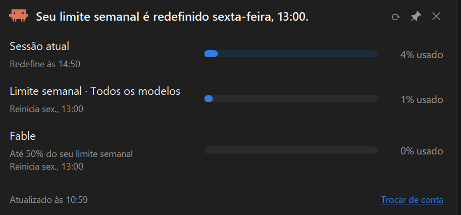
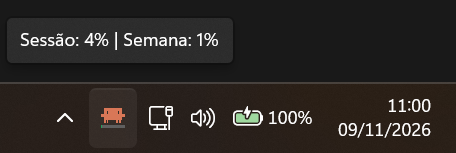
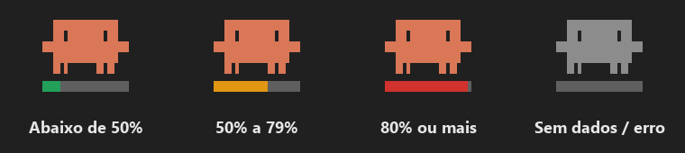
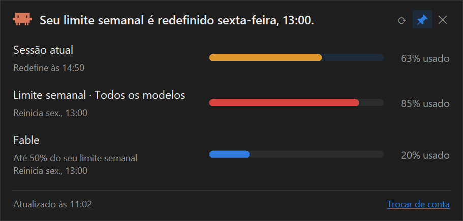
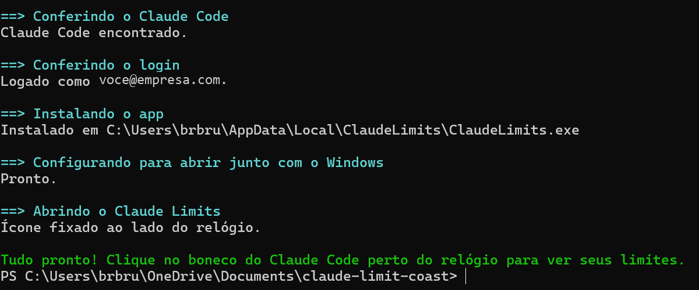

# Claude Limits

Mostra os limites de uso do Claude Code ao lado do relógio do Windows.



## O que ele mostra

### Ícone na bandeja

O boneco do Claude Code fica ao lado do relógio. Passe o mouse por cima para ver um resumo.



A **barra embaixo do boneco** mostra quanto você já usou da sessão (janela de 5h):



### Painel

**Clique no boneco** para abrir um painel no estilo da página de uso do Claude. Ele mostra a sessão atual, o limite semanal e os limites por modelo, cada um com o horário em que reinicia.

As barras mudam de cor conforme o uso: azul até 49%, amarelo de 50% a 79% e vermelho a partir de 80%.



## Instalação: um comando

Não precisa instalar nada antes: se o **Claude Code** não estiver na máquina, o instalador instala.

1. Clone o repositório e entre na pasta:

```bash
git clone https://github.com/reissbruno/claude-limits.git
```

```bash
cd claude-limits
```

2. Rode **um comando**, no PowerShell ou no Prompt de Comando:

```bash
.\instalar.cmd
```

Esse comando faz tudo sozinho:

1. Procura o Claude Code: no terminal ou dentro da extensão do VS Code ou do Cursor. **Se não achar, instala** pelo instalador oficial da Anthropic e coloca o comando `claude` no PATH.
2. **Faz o login**, se você ainda não estiver logado: o navegador abre, você entra na sua conta Claude e autoriza.
3. Instala o app em `%LOCALAPPDATA%\ClaudeLimits`.
4. Configura para abrir **junto com o Windows**.
5. Abre o app e **fixa o ícone ao lado do relógio**, fora da setinha `^`.



**Para atualizar**, entre na pasta, rode `git pull` e depois rode `.\instalar.cmd` de novo.

**Para remover**, rode o comando abaixo, dentro da pasta. Ele fecha o app, apaga o `.exe` e tira o app da inicialização do Windows. O seu login do Claude Code continua como estava.

```bash
.\desinstalar.cmd
```

## Como usar

| Ação | O que faz |
|---|---|
| Clique no boneco | Abre ou fecha o painel |
| ⟳ no painel | Atualiza na hora (sozinho, atualiza a cada 3 min) |
| 📌 no painel | Fixa o painel na tela: ele não fecha sozinho e pode ser arrastado pelo título |
| ✕ ou Esc | Fecha o painel |
| Botão direito no boneco | Menu: painel flutuante, atualizar, trocar de conta, iniciar com o Windows, sair |

## Login e segurança

- O app **não pede nem guarda senha**. Ele usa o login do Claude Code do seu computador: a cada consulta, lê o token de `~/.claude/.credentials.json` e o mantém só na memória.
- O app **não renova o token**, para não atrapalhar o Claude Code.
  - Se o boneco ficar **cinza** com "Login expirado", abra o Claude Code uma vez. Ele renova o login sozinho.
  - Para entrar com outra conta, use **Trocar de conta**, no menu ou no rodapé do painel.
    - Primeiro ele sai da conta atual do **Claude Code**: a conta do app e a do Claude Code são a mesma.
    - Depois abre o login. Se o navegador entrar direto na conta antiga, saia dela no claude.ai, ou abra o link do terminal numa janela anônima (Ctrl+Shift+N).
- Os números são **da sua conta**: incluem o uso do Claude Code em qualquer lugar onde você estiver logado.

## Problemas comuns

- **O ícone ficou escondido na setinha `^`.** Arraste-o para a barra. Outra opção: em Configurações → Personalização → Barra de tarefas → Outros ícones da bandeja do sistema, ative **ClaudeLimits**.
- **O antivírus reclamou do `.exe`.** Isso acontece porque o arquivo não tem assinatura digital. Libere o `ClaudeLimits.exe`.
- **Aparece "Sem login no Claude Code".** Rode `claude auth login` no terminal, ou use **Trocar de conta**.

> ⚠️ Os dados vêm do mesmo endpoint que o comando `/usage` do Claude Code usa. Não é uma API pública documentada e pode mudar sem aviso.

---

## Para quem mantém o projeto

Arquivos do projeto:

- `claude_limits.pyw`: código do app (Python, com `pystray` e `Pillow`).
- `claude-code.svg`: ícone do boneco, usado no painel e no `.exe`.
- `bin/ClaudeLimits.exe`: o app pronto. É ele que o `instalar.cmd` instala.
- `instalar.cmd` e `desinstalar.cmd`: os comandos que o usuário roda. Eles só chamam o `instalar.ps1` e o `desinstalar.ps1`, que fazem o trabalho.
- `docs/`: as imagens deste README e o `app.ico`.

Para rodar sem gerar o `.exe`:

```bash
python -m pip install --user -r requirements.txt
```

```bash
pythonw claude_limits.pyw
```

Para gerar uma versão nova do `.exe` em `bin\`:

```bash
python -m PyInstaller --noconfirm --onefile --windowed --name ClaudeLimits --icon docs/app.ico --add-data "claude-code.svg;." --distpath bin claude_limits.pyw
```

Depois faça commit e push do `bin/ClaudeLimits.exe`. A equipe recebe a versão nova com `git pull` e `.\instalar.cmd`.
